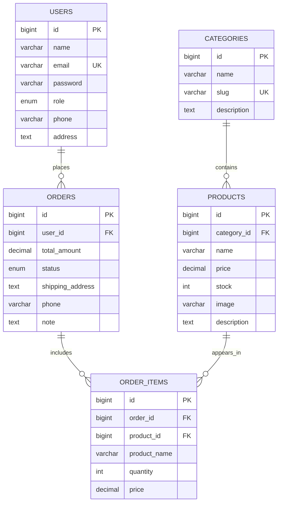

# Thiết kế cơ sở dữ liệu SmartCart

Có 5 bảng nghiệp vụ. Những bảng sessions, cache, jobs và password_reset_tokens được Laravel tạo để hỗ trợ framework, không phải bảng nghiệp vụ bổ sung.

Tất cả bảng có `created_at`, `updated_at`. Users còn có `email_verified_at`, `remember_token` theo Laravel.

| Ràng buộc | Quy tắc |
|---|---|
| users.email / categories.slug | Unique |
| products.category_id | FK, restrict delete |
| orders.user_id | FK, restrict delete |
| order_items.order_id | FK, cascade delete |
| order_items.product_id | FK, restrict delete |
| order_items(order_id, product_id) | Unique: mỗi sản phẩm một dòng trong đơn |
| users.role | admin hoặc customer, mặc định customer |
| orders.status | pending, processing, completed, cancelled |

Khác bản kế hoạch ban đầu, xóa danh mục không cascade sang sản phẩm. Quy tắc restrict ngăn mất sản phẩm ngoài ý muốn và bảo vệ lịch sử mua hàng. Chỉ order_items phụ thuộc hoàn toàn vào orders nên dùng cascade ở quan hệ đó. Các chức năng CRUD phải báo lý do khi không thể xóa.

Giá và tổng tiền dùng decimal(12,2); order_items giữ giá/tên tại thời điểm mua. Checkout và kiểm soát tồn kho thuộc phần triển khai của thành viên 3.
