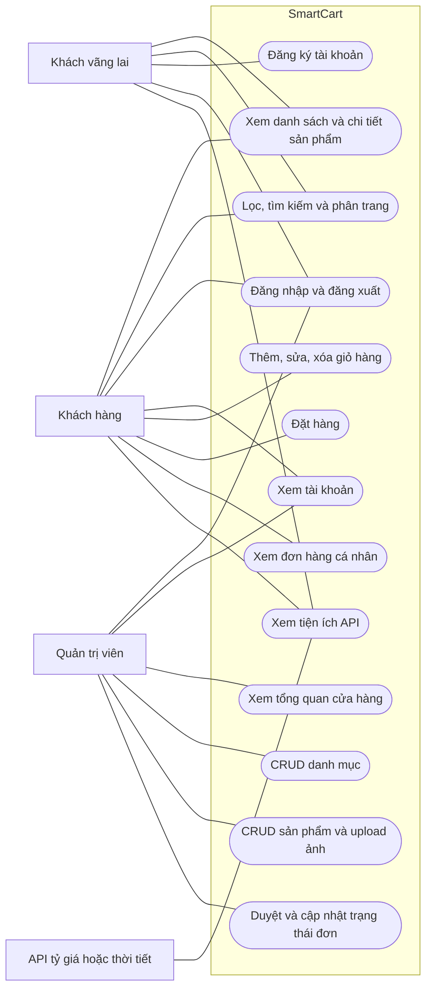

# Use Case SmartCart

Phạm vi bên dưới mô tả toàn bộ đề tài dự kiến. Bộ khung hiện đã triển khai đăng ký, đăng nhập/đăng xuất, tài khoản, phân quyền và tổng quan Admin. Các chức năng mua hàng/CRUD còn lại thuộc các thành viên 2–4.

Sơ đồ Mermaid là nguồn tham khảo quan hệ actor–chức năng. Khi viết báo cáo, dùng bảng dưới để dựng sơ đồ UML Use Case chính thức với actor, biên hệ thống và oval trong draw.io; flowchart trên không thể hiện đầy đủ ký pháp UML.

| Actor | Use Case chính | Điều kiện |
|---|---|---|
| Guest | Xem/lọc/tìm kiếm sản phẩm, đăng ký, đăng nhập, xem widget | Không cần đăng nhập |
| Customer | Các chức năng xem sản phẩm, tài khoản, giỏ hàng, đặt hàng, lịch sử đơn, đăng xuất | Đặt hàng/lịch sử/tài khoản yêu cầu auth; chỉ truy cập đơn của mình |
| Admin | Tổng quan, CRUD danh mục và sản phẩm, upload ảnh, quản lý trạng thái đơn | auth và role:admin |
| API ngoài | Cung cấp thông tin cho widget | Xử lý timeout/lỗi API |

Checkout bao gồm kiểm tra giỏ hàng, tồn kho, thông tin giao hàng và ghi đơn. Chưa có yêu cầu thanh toán trực tuyến; không đưa cổng thanh toán vào phạm vi bàn giao này.
