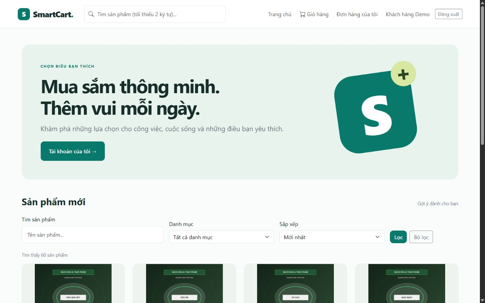
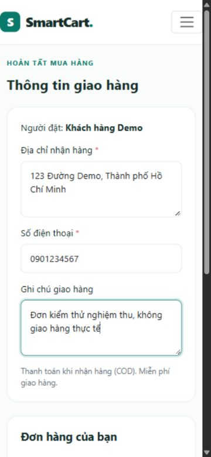
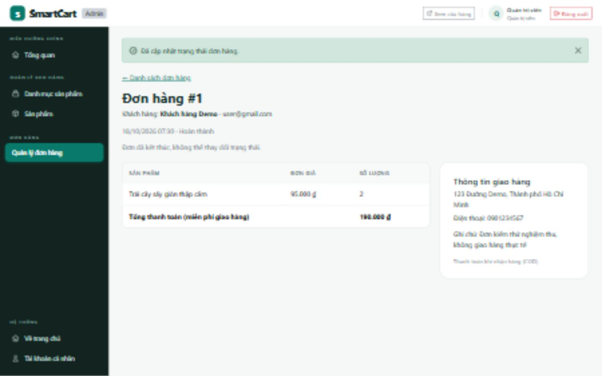
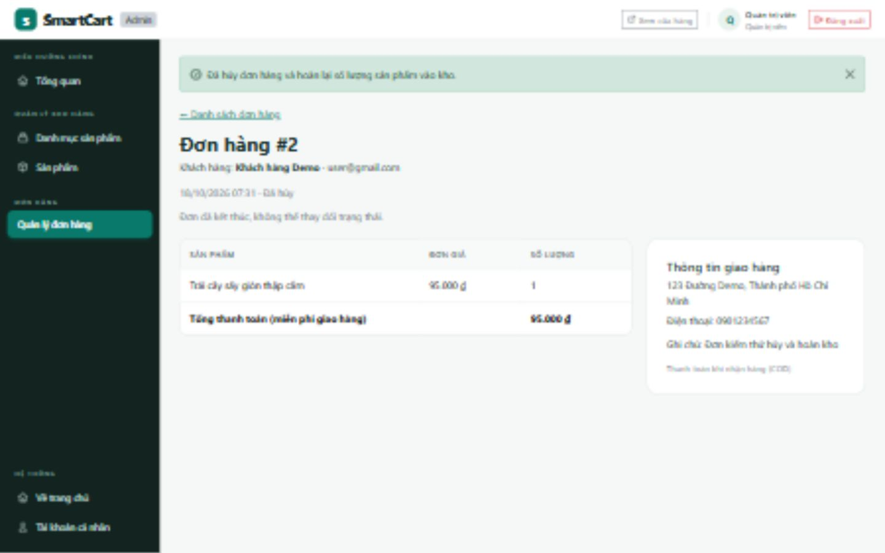
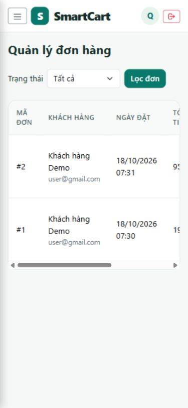
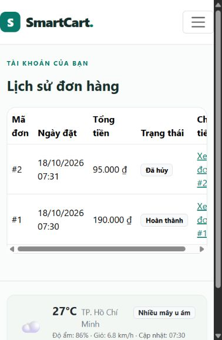

# Báo cáo nghiệm thu SmartCart

Ngày cập nhật: 18/10/2026. Mã nghiệp vụ: `316a2ac` trên `integration/admin-cart`, gồm module số 3 ở `ae4649a` và sửa thanh Admin trên mobile. Báo cáo ghi kết quả đã quan sát; các mục chưa chạy giữ trạng thái chờ.

## 1 Mục tiêu và phạm vi

SmartCart là website bán hàng phục vụ bài tập lớn môn Mã Nguồn Mở, nhóm 4 thành viên. Ứng dụng dùng Laravel 13.35.0, PHP 8.3.33, MySQL 8.4.3, Eloquent, Migration, Seeder, Blade và Bootstrap 5.3.3. Phạm vi là COD và miễn phí giao hàng; chưa kết nối cổng thanh toán hoặc vận chuyển thực tế.

## 2 Chức năng đã tích hợp

| Vai trò | Chức năng |
|---|---|
| Guest | Danh sách, bộ lọc, tìm kiếm/phân trang 8 sản phẩm; chi tiết; giỏ session; live search; đăng ký/đăng nhập |
| Customer | Đặt hàng COD, lịch sử/chi tiết đơn của mình, hủy đơn pending |
| Admin | Dashboard; CRUD danh mục và sản phẩm; upload/validation; lọc/xem đơn; chuyển trạng thái và hủy pending/processing |

Giỏ dùng Fetch để cập nhật số lượng và tổng tiền; thông báo tên sản phẩm dùng văn bản an toàn. Widget Open-Meteo là phần mở rộng; lỗi API không được làm hỏng luồng mua hàng.

## 3 Thiết kế dữ liệu và kiểm soát nghiệp vụ

Có 5 bảng nghiệp vụ: users, categories, products, orders, order_items. Các bảng session/cache/jobs phục vụ framework. Xem [ERD](../ERD.md) và [Use Case](../USE_CASE.md).

`orders.checkout_token` là UUID nullable, unique, bổ sung bằng migration mới; dùng chống gửi lặp. Giá dùng decimal(12,2). Checkout tính tổng bằng số nguyên theo phần trăm đơn vị tiền; lưu giá và tên tại thời điểm mua vào order_items. Không tin giá, tổng tiền hoặc user_id do client gửi.

Checkout khóa tồn kho, tạo order/items và trừ kho trong một transaction; lỗi giữa chừng rollback và giữ giỏ. Hủy khóa đơn rồi sản phẩm, đọc trạng thái mới từ DB; hủy lặp không hoàn kho lần hai. Customer chỉ hủy đơn của mình khi pending; Admin được hủy pending/processing; completed không được hủy. Doanh thu Dashboard chỉ cộng completed.

## 4 Bằng chứng kiểm thử

| Kiểm tra | Kết quả |
|---|---|
| Bộ test bản đầy đủ trên SQLite | 79/79, 636 assertions |
| Bộ test bản đầy đủ trên MySQL riêng | 79/79, 636 assertions |
| Hai khách tranh sản phẩm cuối, cùng token gửi đồng thời | Đạt trong review MySQL của 4e065fa; không có thay đổi CheckoutController trong bản sửa ae4649a |
| Hủy cùng đơn đồng thời; hủy và hoàn thành đồng thời | Hai ca bổ sung đạt trên MySQL ở ae4649a |
| Clone và composer install từ lock | Đạt trên thư mục sạch cùng máy; 115 gói, không copy vendor/.env |
| Migrate/seed, seed lần hai, storage link | Đạt; 2 tài khoản demo, 8 danh mục, 60 sản phẩm |
| Browser desktop/mobile/tablet | Đã chạy các luồng mô tả bên dưới; không thay cho nghiệm thu mọi trang/thiết bị |
| Máy vật lý thứ hai | Chờ thành viên chạy và gửi biên bản |

Các test cạnh tranh bổ sung nằm trong môi trường review tách biệt, chưa được đưa thành bộ test đã commit của repo. Không cộng các test đó vào số 79.

## 5 Luồng demo thực tế ngày 18/10

Trình duyệt chạy bản clone sạch trên cổng 8018, database smartcart_acceptance_20261018, tách biệt dữ liệu làm việc. Sản phẩm thử id 60 có đơn giá 95.000 đồng, stock ban đầu 35. Dùng tài khoản demo và thông tin giao hàng giả.

| Mốc | Trạng thái / tiền | Tồn kho sản phẩm 60 |
|---|---|---|
| Trước thao tác | Chưa có đơn | 35 |
| Đặt đơn 1, số lượng 2 | pending, 190.000 đồng | 33 |
| Đặt đơn 2, số lượng 1 | pending, 95.000 đồng | 32 |
| Admin xử lý đơn 1 | processing → completed | 32 |
| Admin chuyển đơn 2 sang processing rồi hủy | cancelled, hoàn lại 1 | 33 |
| Đối chiếu cuối | Đơn 1 completed 190.000; đơn 2 cancelled 95.000; doanh thu completed 190.000 | 33 |

Khách đăng nhập lại thấy hai trạng thái đúng trong lịch sử. Giỏ được xóa sau checkout thành công. Trên mobile 375×812 đã thử checkout, chi tiết đơn, menu khách, live search và danh sách/menu Admin; trên tablet 768×1024 đã thử bộ lọc q=0; desktop 1440×900 đã thử giỏ và xử lý đơn.

Thanh Admin từng tràn nhẹ ở 375 px; đã chỉnh khoảng cách và ẩn badge Admin trên màn hình rất nhỏ. Đo lại pageWidth = viewport = 375. Bảng đơn hàng cuộn ngang bên trong khung, không đẩy rộng cả trang. Đây là kiểm tra viewport trình duyệt, chưa thay thế thiết bị điện thoại thật.

## 6 Ảnh giao diện

Trang chủ sau cài sạch, có bộ lọc và dữ liệu mẫu.

Thông tin giao hàng trên viewport mobile; dữ liệu nhập phục vụ kiểm thử.

Admin xử lý đơn 1 tới completed.

Đơn 2 được hủy và hoàn lại tồn kho; kết quả kho được đối chiếu bằng SQL.

Thanh điều hướng đã vừa màn hình, bảng cuộn trong khung.

Khách nhìn thấy đơn hoàn thành và đơn đã hủy sau khi Admin xử lý.

## 7 Phân công và bàn giao

Số 1 phụ trách nền tảng, CSDL, Auth/role, tích hợp và báo cáo. Số 2 phụ trách CRUD/ảnh/validation. Số 3 phụ trách giao diện khách và nghiệp vụ đơn hàng. Số 4 phụ trách giỏ Fetch, live search, thông báo và widget. Thông tin lớp, giảng viên và MSSV vẫn để trống theo yêu cầu của nhóm.

Hướng dẫn máy khác: [INSTALL_ACCEPTANCE.md](../INSTALL_ACCEPTANCE.md). Kịch bản thuyết trình: [PRESENTATION_SCRIPT.md](../PRESENTATION_SCRIPT.md). Trạng thái từng ca: [TEST_CHECKLIST.md](../TEST_CHECKLIST.md).

## 8 Điều kiện còn mở trước khi nộp

- Có kết quả cài đặt và chạy demo từ máy thứ hai.
- Hoàn thành các ca còn chờ trong checklist, đặc biệt CSRF thực, API lỗi/timeout và những màn hình chưa nghiệm thu.
- Kiểm tra bố cục Word/PDF trước khi nộp; không coi bản Word là đã kiểm tra hình thức nếu chưa render/đọc từng trang.
- Điền thông tin bìa, xác nhận phân công thực tế và tập dượt kịch bản chung.

Nhánh tích hợp đã chứa đủ module; chưa gộp main khi các điều kiện nghiệm thu còn mở.
